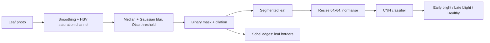
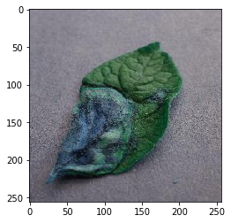
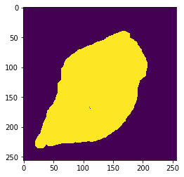
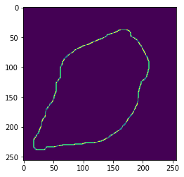
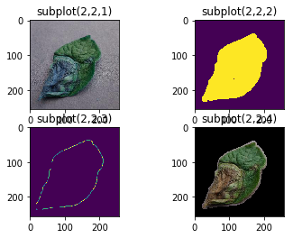

# Plant Leaf Disease Detection (CNN + OpenCV)

Detects potato leaf diseases from a photo: **early blight**, **late blight** or **healthy**.
An OpenCV pipeline isolates the leaf from the background, then a convolutional neural network (Keras / TensorFlow) classifies it.

Final-year B.E. (Computer Science) team project at Osmania University, Hyderabad. This was where my interest in ML started; today I run the cloud infrastructure for production AI workloads (Azure OpenAI), and the "what I would do today" section below is how I would rebuild it now.

**Demo:** [`docs/demo.mp4`](docs/demo.mp4), a 1-minute run of the pipeline in Jupyter.

## How it works



| Input leaf | Binary mask | Leaf borders | Segmented leaf |
|---|---|---|---|
|  |  |  |  |

**Segmentation** (`notebooks/Segmentation.ipynb`): smoothing filter, conversion to HSV and use of the saturation channel, median and Gaussian blur to remove noise, Otsu thresholding, a sharpening kernel, then a dilated binary mask that removes the background.

**Borders** (`notebooks/getborders.ipynb`): Sobel gradients in X and Y combined into an edge map of the leaf outline.

**Model** (`notebooks/cnn_new.ipynb`): two Conv2D (32 filters, 3x3, ReLU) + MaxPooling blocks, a 128-unit dense layer and a 3-class output, trained with Adam on 64x64 images with shear, zoom and horizontal-flip augmentation.

**Prediction** (`notebooks/predict_potato.ipynb`, `notebooks/potato_final.ipynb`): runs the whole pipeline on one image and prints the predicted disease.

## Data and results

- Potato leaf images from the public [PlantVillage dataset on Kaggle](https://www.kaggle.com/emmarex/plantdisease) (not redistributed here; download it and place it under `notebooks/data/train` and `notebooks/data/test`, one folder per class).
- 1,507 training images and 645 test images across 3 classes (about a 70 / 30 split).
- Reported validation accuracy after 250 epochs: about **98%**.

An honest note from today: the model used a sigmoid output with binary cross-entropy, so Keras reported *binary* accuracy, which overstates multi-class performance. See below.

## Run it

```bash
pip install -r requirements.txt
cd notebooks
jupyter notebook   # run cnn_new.ipynb to train, then potato_final.ipynb on samples/<image>.jpg
```

## What I would do today

- Softmax output with categorical cross-entropy, and report per-class precision, recall and a confusion matrix instead of a single accuracy number.
- Transfer learning (for example EfficientNet or MobileNet) on larger 224x224 inputs, with a stratified validation split and early stopping instead of a fixed 250 epochs.
- Package the pipeline as a Python module with tests instead of chained notebooks.
- Track experiments and models with MLflow, and serve the model behind an API (Azure Machine Learning or a container on Azure Container Apps) with CI/CD.

## Tech

Python, TensorFlow / Keras, OpenCV, NumPy, Matplotlib, Jupyter (Anaconda).

## Credits

Team project by three students under the guidance of our faculty advisor at Osmania University. Dataset: PlantVillage via Kaggle.

Maintained by [Vaishnavi Akki](https://github.com/vaishnavia4) · [Portfolio](https://vaishnavia4.github.io/Vaishnavi-Portfolio/)
